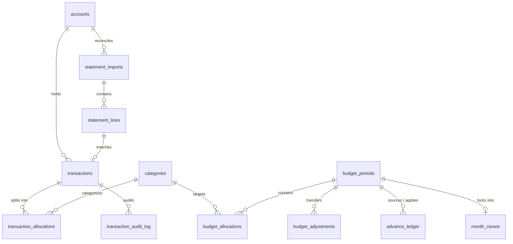
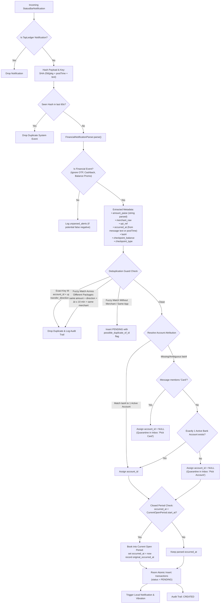
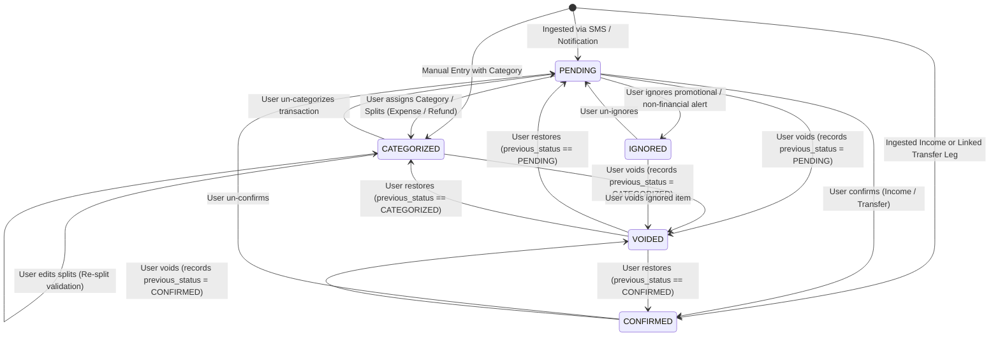
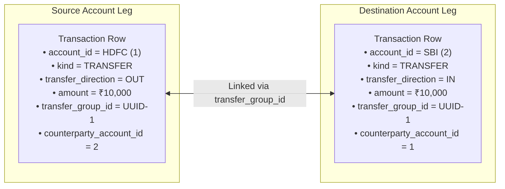
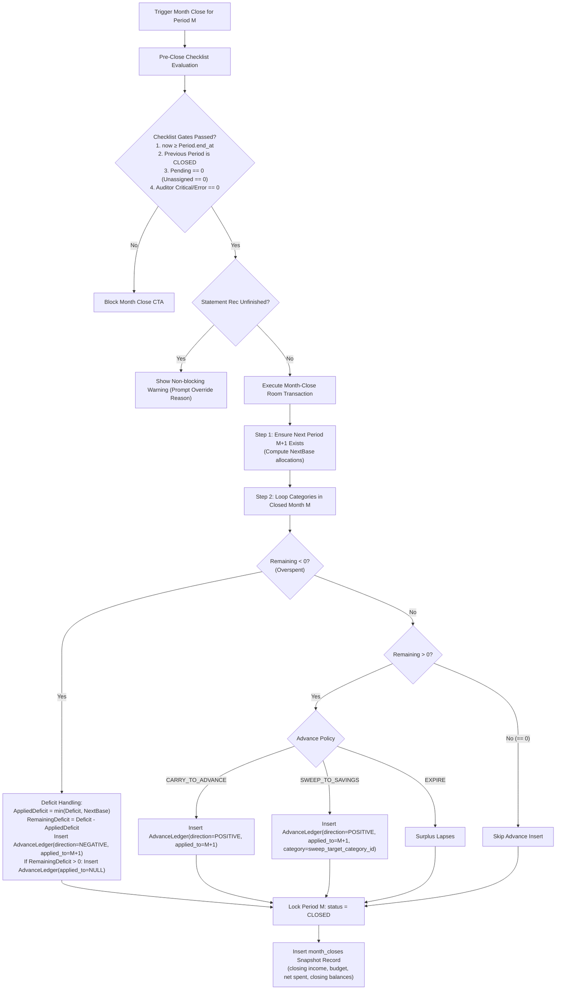
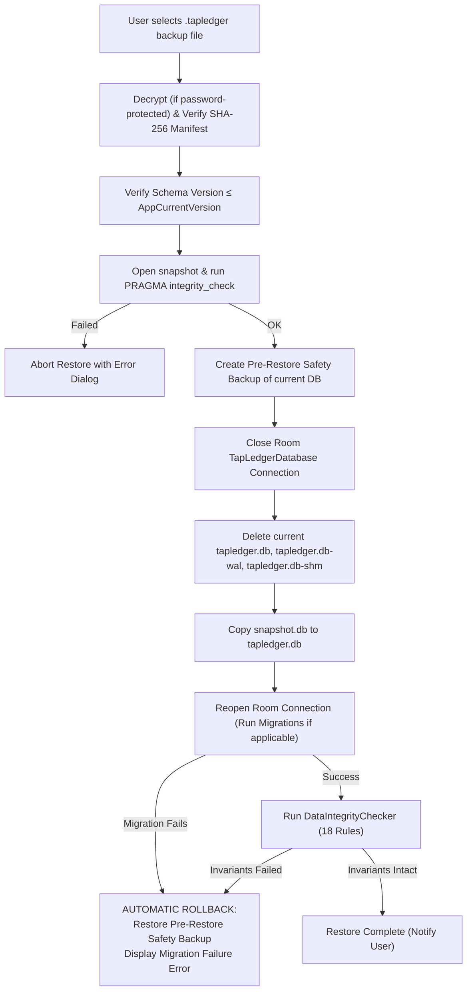
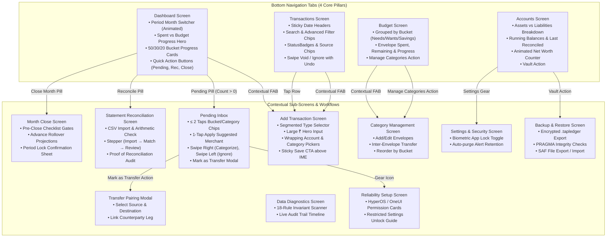

# TapLedger: Complete System Flows & Mathematical Specification

> **Version:** 2.2 (Formal Specification & Production Engine Architecture)  
> **Target OS:** Android 10+ (API 29–36, Android 16 Ready), Optimized for Xiaomi/HyperOS, Samsung OneUI, and Pixel  
> **Core Architectural Principles:** Single-user, 100% offline-first, Zero floating-point arithmetic (`Long` paise only), Double-entry ledger integrity, Asia/Kolkata (`IST`) timezone.

---

## Table of Contents

1. [Core Mathematical Primitives & String-Based Money Parsing](#1-core-mathematical-primitives--string-based-money-parsing)
2. [Data Model & Comprehensive Entity-Relationship Architecture](#2-data-model--comprehensive-entity-relationship-architecture)
3. [Notification Ingestion, Deduplication & Safe Attribution](#3-notification-ingestion-deduplication--safe-attribution)
4. [Transaction Lifecycle & Complete State Machine](#4-transaction-lifecycle--complete-state-machine)
5. [Pending Inbox & Adaptive Merchant Learning](#5-pending-inbox--adaptive-merchant-learning)
6. [Account Balance & Net Worth Mathematics](#6-account-balance--net-worth-mathematics)
7. [Transfer Architecture & Counterparty Pairing](#7-transfer-architecture--counterparty-pairing)
8. [50/30/20 Envelope Budgeting System](#8-503020-envelope-budgeting-system)
9. [Multi-Split Category Allocation & Refund Apportionment Math](#9-multi-split-category-allocation--refund-apportionment-math)
10. [Month-Close & Ordered Deficit Carry-Forward Engine](#10-month-close--ordered-deficit-carry-forward-engine)
11. [Bank Statement Reconciliation Engine & Mathematical Proof](#11-bank-statement-reconciliation-engine--mathematical-proof)
12. [Data Integrity & Invariant Auditor (18 Formal Rules)](#12-data-integrity--invariant-auditor-18-formal-rules)
13. [Atomic Backup, Manifest Bundling & Safe Restore Protocol](#13-atomic-backup-manifest-bundling--safe-restore-protocol)
14. [Security, Privacy, and System Health Architecture](#14-security-privacy-and-system-health-architecture)
15. [End-to-End Application Screen Flow](#15-end-to-end-application-screen-flow)
16. [Engineering Guarantees & Non-Claims](#16-engineering-guarantees--non-claims)

---

## 1. Core Mathematical Primitives & String-Based Money Parsing

### 1.1 The Integer-Only Rule (Zero Float / Zero Double)

All financial storage and arithmetic in TapLedger are strictly executed as **signed 64-bit integers (`Long`) in Indian Paise**:
$$\text{paise} = \text{rupees} \times 100$$
Floating-point primitives (`Float`, `Double`, `BigDecimal` conversions through double) are strictly forbidden in calculation engines and storage. Binary floating-point arithmetic fails on decimal numbers (e.g., $1.15 \times 100 = 114.99999999999999$), causing financial balance drift.

### 1.2 Deterministic String-Based Paise Parser

To prevent floating-point inaccuracies and parse string currencies robustly:

```kotlin
fun parseRupeesStringToPaise(raw: String): Long {
    // 1. Strip trailing sentence punctuation (e.g. "Rs. 500.00."), symbols, and whitespace
    var cleaned = raw.trim().trimEnd('.')
    cleaned = cleaned.replace(Regex("[₹,\\s]|Rs\\.?|INR", RegexOption.IGNORE_CASE), "").trim()
    if (cleaned.isEmpty()) throw IllegalArgumentException("Empty amount: $raw")

    // 2. Tokenize on decimal point
    val parts = cleaned.split(".")
    if (parts.size > 2) throw IllegalArgumentException("Multiple decimal points: $raw")

    // 3. Whole part parsing (support empty leading whole for inputs like ".50" -> 0)
    val wholeStr = if (parts[0].isEmpty()) "0" else parts[0]
    if (!wholeStr.all { it.isDigit() }) throw IllegalArgumentException("Non-digit whole part: $raw")
    val wholePart = wholeStr.toLong()

    // 4. Fraction part parsing
    val fractionStr = if (parts.size == 2) parts[1] else ""
    if (fractionStr.isNotEmpty() && !fractionStr.all { it.isDigit() }) {
        throw IllegalArgumentException("Non-digit fraction part: $raw")
    }
    if (fractionStr.length > 2) {
        throw IllegalArgumentException("Sub-paise precision rejected (>2 decimals): $raw")
    }

    // Right-pad single digit (e.g., ".5" -> "50") or use "00"
    val paddedFraction = fractionStr.padEnd(2, '0').toLong()

    return Math.addExact(Math.multiplyExact(wholePart, 100L), paddedFraction)
}
```

### 1.3 Indian Numbering System & Tabular Figures

Display conversion is performed exclusively at the UI boundary via `MoneyFormatter`:

- Format pattern: Indian grouping (`12,34,567.89`).
- Rendered with tabular proportional numerals (`fontFeatureSettings = "tnum"`).
- **Semantic Display:**
  $$\text{Income / Refund / Interest Earned: } +\text{₹}X.XX \quad (\text{IncomeGreen})$$
  $$\text{Expense / Fee / Interest Charged: } -\text{₹}X.XX \quad (\text{ExpenseRed})$$
  $$\text{Credit Card / Loan Debt: } -\text{₹}X.XX \text{ or } \text{₹}X.XX \text{ owed}$$

### 1.4 Timezone & Period Boundary Invariant

- Storage timestamps: Epoch milliseconds (`Long`).
- All day, month, and year boundaries are computed in **`Asia/Kolkata` (`IST` / `UTC+05:30`)**.
- Budget periods follow **half-open intervals**:
  $$[\text{start\_at}, \text{end\_at}) = \{t \mid \text{start\_at} \le t < \text{end\_at}\}$$
  This prevents boundary overlap between consecutive months (`end_at` of Month $M$ is the exact `start_at` of Month $M+1$).
- Opening balance dates are anchored to **`StartOfDayIST(opening_balance_date)`** ($00:00:00.000$ IST), so same-day opening transactions are captured.

---

## 2. Data Model & Comprehensive Entity-Relationship Architecture



### Table Schema Specifications

- **`accounts`**:
  `id` (PK), `name`, `type` (`BANK`, `CREDIT_CARD`, `CASH`, `INVESTMENT`, `LOAN`, `WALLET`), `identifier_last4`, `opening_balance_paise` (signed integer, negative for CC/LOAN debt), `opening_balance_date` (epoch ms, start-of-day IST), `credit_limit_paise`, `statement_day`, `due_day`, `is_active`, `created_at`, `updated_at`.
- **`transactions`**:
  `id` (PK), `account_id` (FK, Nullable), `kind` (`EXPENSE`, `INCOME`, `REFUND`, `TRANSFER`, `FEE`, `INTEREST_CHARGED`, `INTEREST_EARNED`, `ADJUSTMENT`), `amount_paise` (> 0), `merchant_raw`, `status` (`PENDING`, `CONFIRMED`, `CATEGORIZED`, `IGNORED`, `VOIDED`), `previous_status`, `source` (`SMS`, `NOTIFICATION`, `STATEMENT`, `MANUAL`), `occurred_at` (epoch ms), `original_occurred_at` (epoch ms, nullable), `upi_reference`, `transfer_group_id` (UUID, nullable), `counterparty_account_id` (FK, nullable), `transfer_direction` (`OUT`, `IN`, nullable), `refund_of_transaction_id` (FK, nullable), `possible_duplicate_of_id` (FK, nullable), `checkpoint_balance_paise` (nullable), `checkpoint_type` (`AVAILABLE_BALANCE`, `AVAILABLE_CREDIT_LIMIT`, `TOTAL_OUTSTANDING`, nullable), `notes`, `created_at`, `updated_at`.
- **`transaction_allocations`**:
  `id` (PK), `transaction_id` (FK), `category_id` (FK), `amount_paise` (> 0).  
  _Unique Composite Index:_ `(transaction_id, category_id)`.
- **`categories`**:
  `id` (PK), `name`, `default_bucket` (`NEEDS`, `WANTS`, `SAVINGS`), `default_sort_order`, `default_advance_policy` (`CARRY_TO_ADVANCE`, `SWEEP_TO_SAVINGS`, `EXPIRE`), `sweep_target_category_id` (FK, nullable), `is_active`.
- **`budget_periods`**:
  `id` (PK), `year`, `month`, `start_at` (inclusive), `end_at` (exclusive), `income_paise` (planned/budgeted target), `status` (`OPEN`, `CLOSED`), `created_at`, `updated_at`.  
  _Unique Composite Index:_ `(year, month)`.
- **`budget_allocations`**:
  `id` (PK), `budget_period_id` (FK), `category_id` (FK), `category_name_snapshot`, `bucket_snapshot` (`NEEDS`, `WANTS`, `SAVINGS`), `sort_order_snapshot`, `advance_policy_snapshot`, `amount_paise` ($\ge 0$).  
  _Unique Composite Index:_ `(budget_period_id, category_id)`.
- **`budget_adjustments`**:
  `id` (PK), `budget_period_id` (FK), `from_category_id` (FK), `to_category_id` (FK), `amount_paise` (> 0), `reason`, `created_at`.
- **`advance_ledger`**:
  `id` (PK), `source_period_id` (FK), `applied_to_period_id` (FK, Nullable), `category_id` (FK), `amount_paise` (> 0), `direction` (`POSITIVE`, `NEGATIVE`), `reason`, `created_at`.
- **`month_closes`**:
  `id` (PK), `budget_period_id` (FK, Unique), `closed_at`, `total_income_paise`, `total_budgeted_paise`, `total_spent_paise`, `reconciliation_status`, `override_reason`, `closing_balances_json`.
- **`statement_imports`**:
  `id` (PK), `account_id` (FK), `period_start`, `period_end`, `opening_balance_paise`, `closing_balance_paise`, `total_debits_paise`, `total_credits_paise`, `line_count`, `status` (`IMPORTED`, `RECONCILED`, `ARITHMETIC_ERROR`, `CANCELLED`), `created_at`.
- **`statement_lines`**:
  `id` (PK), `import_id` (FK), `transaction_date`, `value_date`, `description`, `reference`, `debit_paise`, `credit_paise`, `balance_after_paise`, `matched_transaction_id` (FK), `match_status` (`MATCHED`, `MATCHED_WITH_DISCREPANCY`, `MISSING_IN_APP`, `MISSING_IN_STATEMENT`, `RESOLVED`).
- **`unparsed_alerts`**:
  `id` (PK), `package_name`, `title`, `raw_text`, `occurred_at`, `error_reason`, `created_at`. _(Purged after 30 days)._
- **`merchant_map`**:
  `id` (PK), `merchant_normalized`, `category_id` (FK), `times_confirmed`, `times_overridden`, `last_used_at`.  
  _Unique Composite Index:_ `(merchant_normalized, category_id)`.

---

## 3. Notification Ingestion, Deduplication & Safe Attribution



### 3.1 Attribution & Nullability Invariants

- `transactions.account_id` is **nullable**.
- If an account cannot be resolved unequivocally, `account_id` remains `NULL`.
- **Invariant:** A transaction **cannot leave `PENDING`** while `account_id` is `NULL`.
- Unassigned transactions do not hit any account balance and are excluded from rule `T1`.
- The Pending Inbox displays an amber warning banner: `"Unassigned Account — Tap to resolve"`.
- Month-close is strictly blocked if any unassigned transaction exists.

---

## 4. Transaction Lifecycle & Complete State Machine



### Comprehensive Status Impact Matrix

| Status            |         Account Balance         | Budget Spending | Category Envelopes | Statement Reconciliation | Notes                                            |
| :---------------- | :-----------------------------: | :-------------: | :----------------: | :----------------------: | :----------------------------------------------- |
| **`PENDING`**     | **YES** (if account $\ne$ null) |       NO        |         NO         |         **YES**          | Deducts balance immediately; envelope unassigned |
| **`CONFIRMED`**   |             **YES**             |       NO        |         NO         |         **YES**          | Income and paired transfers                      |
| **`CATEGORIZED`** |             **YES**             |     **YES**     |      **YES**       |         **YES**          | Splits sum exactly to `amount_paise`             |
| **`IGNORED`**     |               NO                |       NO        |         NO         |            NO            | Excluded from financial math                     |
| **`VOIDED`**      |               NO                |       NO        |         NO         |            NO            | Reversible cancellation; audit preserved         |

---

## 5. Pending Inbox & Adaptive Merchant Learning

### 5.1 Dynamic Integer Confidence Scoring

Confidence is computed without floating-point primitives:
$$\text{IsHighConfidence}(M) \iff (\text{times\_confirmed}(M) \times 100\text{L}) \ge (80\text{L} \times (\text{times\_confirmed}(M) + \text{times\_overridden}(M))) \land (\text{times\_confirmed}(M) \ge 2)$$

- **1-Tap Shortcut Displayed:** Shown only when `IsHighConfidence` evaluates to `true`.
- **Guard against Poisoning:**
  1. No learning from split transactions (multi-category splits are ambiguous).
  2. No learning from P2P personal names (VPA containing personal names or phone numbers).
  3. User override increments `times_overridden`, lowering the ratio below $80\%$.

### 5.2 Interaction Latency: $\le 2$ Taps Target

1. **Tap 1 (Bucket Selection):** User taps `Needs`, `Wants`, or `Savings`.
   - Bucket with **exactly 1 category**: Automatically allocates $100\%$ amount and commits. Total = **1 Tap**.
   - Bucket with **multiple categories**: Expands sub-category chips inline.
2. **Tap 2 (Category Selection):** User taps category chip. Allocates $100\%$ and commits. Total = **2 Taps**.

---

## 6. Account Balance & Net Worth Mathematics

### 6.1 Individual Account Balance Formula with As-Of Boundary

For account $A$ as of timestamp $T_{\text{asOf}}$:
$$\text{Balance}(A, T_{\text{asOf}}) = A.\text{opening\_balance\_paise} + \sum_{t \in T_{\text{in}}(A, T_{\text{asOf}})} t.\text{amount\_paise} - \sum_{t \in T_{\text{out}}(A, T_{\text{asOf}})} t.\text{amount\_paise}$$

#### Boundary & Eligibility Rules:

1. $t.\text{occurred\_at} \ge \text{StartOfDayIST}(A.\text{opening\_balance\_date})$.
2. $t.\text{occurred\_at} \le T_{\text{asOf}}$ (caps future-dated transactions from current balance).
3. $t.\text{status} \in \{\text{PENDING}, \text{CONFIRMED}, \text{CATEGORIZED}\}$.
4. **Sign Convention:** Credit card and loan opening balances are stored as **negative integers** ($-\text{₹}8,000.00 = -800000\text{ paise}$).
5. **Locked Opening Balance:** Once any budget period is `CLOSED`, `opening_balance_paise` and `opening_balance_date` are permanently locked from edits.

#### Inflow vs. Outflow Mapping:

- **Inflow ($T_{\text{in}}$):**
  $$\text{Kind} \in \{\text{INCOME}, \text{REFUND}, \text{INTEREST\_EARNED}\} \lor (\text{Kind} = \text{TRANSFER} \land \text{transfer\_direction} = \text{IN})$$
- **Outflow ($T_{\text{out}}$):**
  $$\text{Kind} \in \{\text{EXPENSE}, \text{FEE}, \text{INTEREST\_CHARGED}\} \lor (\text{Kind} = \text{TRANSFER} \land \text{transfer\_direction} = \text{OUT})$$
- **Adjustments:** Reuses `transfer_direction` (`IN` = Inflow, `OUT` = Outflow).

### 6.2 Type-Agnostic Net Worth Identity

To ensure $\text{Assets} - \text{Liabilities} \equiv \sum_{A} \text{Balance}(A)$ holds across all account types:

$$\mathbf{Assets}(T_{\text{asOf}}) = \sum_{A \in \text{Accounts}} \max(\text{Balance}(A, T_{\text{asOf}}), 0\text{L})$$

$$\mathbf{Liabilities}(T_{\text{asOf}}) = \sum_{A \in \text{Accounts}} \max(-\text{Balance}(A, T_{\text{asOf}}), 0\text{L})$$

$$\mathbf{NetWorth}(T_{\text{asOf}}) = \mathbf{Assets}(T_{\text{asOf}}) - \mathbf{Liabilities}(T_{\text{asOf}}) \equiv \sum_{A \in \text{Accounts}} \text{Balance}(A, T_{\text{asOf}})$$

- **Display Grouping & Warnings:**
  - If a `BANK`, `CASH`, or `WALLET` account drops negative, it contributes mathematically to $\text{Liabilities}$ (preserving identity), but the UI renders an amber **Data Inconsistency Warning Banner** (indicating missing opening balance or untracked cash income).
  - `INVESTMENT` accounts support manual asset valuation adjustment transactions (`ADJUSTMENT`).
  - **Credit Card Utilization:**
    $$\text{Utilization\%} = \begin{cases} \min\left(999, \max\left(0, \left\lfloor \frac{|\text{Balance}(A)| \times 100\text{L}}{A.\text{credit\_limit\_paise}} \right\rfloor\right)\right), & \text{if } A.\text{credit\_limit\_paise} > 0 \land \text{Balance}(A) < 0 \\ 0, & \text{otherwise} \end{cases}$$
- **Deactivated Account Rule:** Deactivating an account is blocked unless $\text{Balance}(A, \text{now}) = 0\text{L}$. Hidden accounts remain active in net worth calculations.

### 6.3 Real-Time Balance Drift Formula

When SMS reports a checkpoint balance (e.g., `Avl Bal: Rs 48,700.00`):

$$
\text{ExpectedBankBalance} = \begin{cases}
\text{Balance}(A, t.\text{occurred\_at}), & \text{if } \text{checkpoint\_type} = \text{AVAILABLE\_BALANCE} \\
A.\text{credit\_limit\_paise} - |\text{Balance}(A, t.\text{occurred\_at})|, & \text{if } \text{checkpoint\_type} = \text{AVAILABLE\_CREDIT\_LIMIT} \\
|\text{Balance}(A, t.\text{occurred\_at})|, & \text{if } \text{checkpoint\_type} = \text{TOTAL\_OUTSTANDING}
\end{cases}
$$

$$\mathbf{BalanceDrift} = t.\text{checkpoint\_balance\_paise} - \text{ExpectedBankBalance}$$

- If $\text{BalanceDrift} \ne 0$: A "Reconcile Balance Drift" banner appears on the account card.

---

## 7. Transfer Architecture & Counterparty Pairing

A transfer is a two-legged double-entry transaction. Both legs share a `transfer_group_id` (UUID).



### 7.1 Single SMS Ingestion to Paired Transfer

1. When an SMS alert indicates a transfer (or user taps "Mark as Transfer" in Inbox):
   - Leg 1 (`OUT`) is created for the source account.
   - User selects the destination account (or system matches an incoming `IN` notification).
   - Leg 2 (`IN`) is atomically created with matching `amount_paise`, inverted `transfer_direction`, and shared `transfer_group_id`.
2. **Lifecycle Sync:** Mutating, voiding, ignoring, or restoring one transfer leg **automatically applies to its counterparty leg**.
3. **Credit Card Bill Payments:**
   - $HDFC \rightarrow Card$: HDFC decreases by ₹8,000; Card increases from $-\text{₹}8,000$ to $\text{₹}0$.
   - **Budget Invariant:** Standard transfers carry **zero category allocations** and do not impact expenses. Card purchases were already allocated to budget envelopes at the time of purchase.

---

## 8. 50/30/20 Envelope Budgeting System

### 8.1 Zero-Remainder Target Math

For verified monthly income $I$ (in paise):
$$\text{NeedsTarget} = \left\lfloor \frac{I \times 50\text{L}}{100\text{L}} \right\rfloor$$
$$\text{WantsTarget} = \left\lfloor \frac{I \times 30\text{L}}{100\text{L}} \right\rfloor$$
$$\text{SavingsTarget} = I - \text{NeedsTarget} - \text{WantsTarget}$$

- **Invariant:** $\text{NeedsTarget} + \text{WantsTarget} + \text{SavingsTarget} \equiv I$.
- **Income Definition:** `income_paise` on `budget_periods` represents the budgeted income target. Actual verified income is derived dynamically:
  $$\text{ActualIncome} = \sum_{t \in T_{\text{income}}} t.\text{amount\_paise}$$

### 8.2 Category Adjusted Budget Formula

$$\text{AdjustedBudget}(C) = \text{BaseAllocated}(C) + \text{AdjIn}(C) - \text{AdjOut}(C) + \text{AdvancePositive}(C) - \text{AdvanceNegative}(C)$$

### 8.3 Net Spending Formulation & Savings Envelope Exception

$$\text{NetSpent}(C) = \sum_{t \in T_{\text{exp}}(C)} \text{Allocated}(t, C) - \sum_{t \in T_{\text{ref}}(C)} \text{Allocated}(t, C) + \sum_{t \in T_{\text{sav\_transfer}}(C)} \text{Allocated}(t, C)$$

Where transactions must satisfy:

1. $t.\text{status} = \text{CATEGORIZED}$.
2. $t.\text{occurred\_at} \in [\text{Period.start\_at}, \text{Period.end\_at})$ (Half-open).
3. **Savings Transfer Exception:** Transfers into `INVESTMENT` or deposit accounts carrying a category allocation under the `SAVINGS` bucket are included in $T_{\text{sav\_transfer}}(C)$ so that the Savings envelope reflects progress, while remaining excluded from regular spending expenses.
4. **Fees and Interest:** Bank fees (`FEE`) and interest charged (`INTEREST_CHARGED`) map to a designated Needs category (_"Bank Charges & Fees"_).

### 8.4 Budget Evaluation Order & Percentage Used

To prevent edge-case rounding artifacts:

```kotlin
val isExceeded = netSpent > adjustedBudget || (adjustedBudget == 0L && netSpent > 0L)

val percentageUsed = if (adjustedBudget > 0L) {
    ((netSpent * 100L) / adjustedBudget).coerceIn(0L, 999L).toInt()
} else if (isExceeded) 100 else 0

val isWarning = !isExceeded && percentageUsed in 80..100
```

### 8.5 Actual Savings Metric

$$\mathbf{ActualSavings} = \sum_{C \in \text{SAVINGS}} \text{NetSpent}(C)$$

---

## 9. Multi-Split Category Allocation & Refund Apportionment Math

### 9.1 Split Remainder Invariant

When a transaction $T$ is split across $k$ categories:
$$\sum_{i=1}^{k} \text{AllocationPaise}(i) \equiv T.\text{amount\_paise}$$
Commit is blocked if remainder $\ne 0$, any allocation $\le 0$, or duplicate categories are selected.

### 9.2 Partial Refund Largest-Remainder Apportionment

When a transaction $T$ with $k$ category splits is partially refunded by $R$ paise ($R \le T.\text{amount\_paise}$):

1. Compute exact integer share for each category:
   $$\text{BaseRefund}(i) = \left\lfloor \frac{R \times \text{AllocationPaise}(i)}{T.\text{amount\_paise}} \right\rfloor$$
2. Compute remainders:
   $$\text{Remainder}(i) = (R \times \text{AllocationPaise}(i)) \pmod{T.\text{amount\_paise}}$$
3. Distribute unallocated paise ($R - \sum \text{BaseRefund}(i)$) one paisa at a time to categories sorted by descending $\text{Remainder}(i)$.

- **Rule `R1_CUMULATIVE_REFUND_EXCEEDED`:** Cumulative refunds for transaction $T$ must satisfy $\sum \text{Refunds}(T) \le T.\text{amount\_paise}$. Auto-reversals of failed UPI transactions link automatically via `refund_of_transaction_id`.

---

## 10. Month-Close & Ordered Deficit Carry-Forward Engine



### 10.1 Mathematical Deficit Invariant (Rule `B2` Compliant)

$$\text{Deficit}(C) = |\text{Remaining}(C)| \quad (\text{for } \text{Remaining}(C) < 0)$$
$$\text{AppliedDeficit}(C) = \min(\text{Deficit}(C), \text{NextBase}(C))$$
$$\text{UncoveredDeficit}(C) = \text{Deficit}(C) - \text{AppliedDeficit}(C)$$

- $\text{AppliedDeficit}$ is inserted into `advance_ledger` targeting Month $M+1$.
- $\text{UncoveredDeficit}$ is inserted into `advance_ledger` with `applied_to_period_id = NULL` (persisting indefinitely until future income absorbs it).
- This guarantees $\text{NextAdjustedBudget}(C) = \text{NextBase}(C) - \text{AppliedDeficit}(C) \ge 0\text{L}$, strictly satisfying Rule `B2`.

---

## 11. Bank Statement Reconciliation Engine & Mathematical Proof

### 11.1 Statement Internal Arithmetic Verification

For bank accounts:
$$\text{ExpectedClosing} = \text{OpeningBalance} + \sum \text{Credits} - \sum \text{Debits}$$
For credit card accounts (app sign convention: debt = negative):
$$\text{ExpectedClosing} = \text{OpeningBalance} + \sum \text{Payments/Credits} - \sum \text{Purchases/Debits}$$

- If $\text{ExpectedClosing} \ne \text{ReportedClosing}$: Status set to `ARITHMETIC_ERROR`.
- **Statement Chain Invariant:** $\text{Opening}(S_{n}) \equiv \text{Closing}(S_{n-1})$.

### 11.2 Two-Phase Matching Engine

1. **Phase 1 (UPI / Reference Matching):**
   - Matches `line.reference` against `tx.upi_reference`.
   - If references match but amounts differ: Flagged as `MATCHED_WITH_DISCREPANCY`.
2. **Phase 2 (Global Minimal Delta Matching):**
   - Candidate pairs within statement inclusive range $[period\_start, period\_end]$ with matching amount and direction are scored:
     $$\Delta t = |t.\text{occurred\_at} - \text{line}.\text{transaction\_date}| \le 2 \text{ days} \, (172,800,000 \text{ ms})$$
   - Pairs are sorted globally by $\Delta t$ and assigned greedily, eliminating collision theft.

### 11.3 The Formal Mathematical Proof of Reconciliation

The audit reconciliation identity holds exactly:

$$\mathbf{StmtClosing} - \mathbf{AppBalance}(\text{EndOfDayIST}(period\_end)) \equiv (\mathbf{StmtOpening} - \mathbf{AppBalance}(\text{StartOfDayIST}^-(period\_start))) + \sum_{l \in \text{MISSING\_IN\_APP}} s(l) - \sum_{t \in \text{MISSING\_IN\_STMT}} s(t) + \sum_{m \in \text{DISCREPANCY}} (s(m.\text{line}) - s(m.\text{tx}))$$

Where:
$$s(x) = \begin{cases} +x.\text{amount\_paise}, & \text{if credit / income} \\ -x.\text{amount\_paise}, & \text{if debit / expense} \end{cases}$$

---

## 12. Data Integrity & Invariant Auditor (18 Formal Rules)

The `DataIntegrityChecker` audits the Room database against 18 formal rules:

| Rule Code                            | Invariant Condition                                                                             |   Severity   | Description                                 |
| :----------------------------------- | :---------------------------------------------------------------------------------------------- | :----------: | :------------------------------------------ |
| **`T1_INVALID_ACCOUNT`**             | $\forall t \text{ with status} \ne \text{PENDING}, t.\text{account\_id} \in \text{Accounts.id}$ | **CRITICAL** | Orphaned transaction without account        |
| **`T2_NON_POSITIVE_AMOUNT`**         | $\forall t, t.\text{amount\_paise} > 0$                                                         |  **ERROR**   | Non-positive transaction amount             |
| **`T3_UNPAIRED_TRANSFER`**           | Every paired transfer has exactly 1 OUT and 1 IN leg with equal amounts                         | **CRITICAL** | One-legged or unbalanced transfer           |
| **`T4_DUPLICATE_UPI_REF`**           | Unique non-null `(account_id, upi_reference, transfer_direction, amount_paise)`                 |  **ERROR**   | Duplicate transaction captured              |
| **`A1_SPLIT_SUM_MISMATCH`**          | For categorized $t$: $\sum \text{Allocations} \equiv t.\text{amount\_paise}$                    | **CRITICAL** | Split allocation does not match transaction |
| **`A2_INVALID_CATEGORY`**            | $\forall a, a.\text{category\_id} \in \text{Categories.id}$                                     |  **ERROR**   | Allocation references non-existent category |
| **`A3_NON_POSITIVE_ALLOCATION`**     | $\forall a, a.\text{amount\_paise} > 0$                                                         |  **ERROR**   | Split allocation $\le 0$ paise              |
| **`A4_DUPLICATE_CATEGORY_IN_SPLIT`** | Unique `(transaction_id, category_id)`                                                          |  **ERROR**   | Category repeated in same split             |
| **`B1_INVALID_ADJUSTMENT`**          | $\text{from\_cat} \in \text{Cat} \land \text{to\_cat} \in \text{Cat}$                           |  **ERROR**   | Invalid category reference in transfer      |
| **`B2_NEGATIVE_BUDGET`**             | $\forall b, \text{AdjustedBudget}(b) \ge 0$                                                     | **CRITICAL** | Category adjusted budget dropped negative   |
| **`B3_BUCKET_OVERALLOCATION`**       | $\sum \text{BaseAllocations} \le \text{BucketTarget}$                                           | **WARNING**  | Base envelopes exceed bucket target         |
| **`B4_BUDGET_EQUILIBRIUM`**          | $\sum \text{AdjustedBudget} \equiv \text{Period.income} + \text{NetAdvances}$                   |  **ERROR**   | Budget envelope equilibrium violated        |
| **`C1_DUPLICATE_CATEGORY`**          | Unique active category names                                                                    | **WARNING**  | Ambiguous duplicate categories              |
| **`P1_PERIOD_OVERLAP`**              | No overlapping $[\text{start\_at}, \text{end\_at})$ intervals                                   | **CRITICAL** | Corrupted budget period boundaries          |
| **`M1_LOCKED_MODIFICATION`**         | No row mutations with `updated_at > Period.closed_at`                                           | **CRITICAL** | Violation of historical ledger immutability |
| **`M2_CLOSE_TOTALS_MISMATCH`**       | `month_closes` matches recomputed historical totals                                             |  **ERROR**   | Historical close record tampering           |
| **`S1_STATEMENT_MISMATCH`**          | Internal statement arithmetic equals reported closing                                           | **WARNING**  | Bank CSV arithmetic mismatch                |
| **`R1_CUMULATIVE_REFUND_EXCEEDED`**  | $\sum \text{Refunds}(T) \le T.\text{amount\_paise}$                                             |  **ERROR**   | Refunds exceed original charge              |

---

## 13. Atomic Backup, Manifest Bundling & Safe Restore Protocol

### 13.1 Atomic Snapshot & Encrypted Bundle Creation

1. Triggers SQLite `VACUUM INTO 'snapshot.db'` (atomic snapshot).
2. Runs `PRAGMA integrity_check;` on snapshot connection.
3. Computes SHA-256 checksum, schema version, and record count manifest (`manifest.json`).
4. Bundles `snapshot.db` and `manifest.json` into a single archive (`.tapledger`).
5. **Optional Password Protection:** Encrypts archive using **AES-256-GCM** with keys derived via **Argon2id** (or PBKDF2-HMAC-SHA256, 600,000 iterations).
6. Exports via Android Storage Access Framework (SAF) to user-chosen destination.

### 13.2 Safe Restore Protocol with Rollback Guard



---

## 14. Security, Privacy, and System Health Architecture

### 14.1 Android Security & Privacy Boundaries

- `AndroidManifest.xml`: `android:allowBackup="false"`.
- `data_extraction_rules.xml`: Disables cloud and device-to-device transport of SQLite databases, encryption keys, and alert logs.
- No `android.permission.INTERNET` declared. The application code cannot transmit data over the network.
- **App Lock & Display Security:** Optional Android BiometricPrompt (Fingerprint/PIN); sets `FLAG_SECURE` on sensitive activities to prevent screenshot and app switcher leaks.

### 14.2 Notification Listener Health & Rebind Protocol

- **Adaptive Health Check:** Calculates expected daily notification frequency based on user history; warns only when gap exceeds $3\times$ average inter-arrival time.
- **WorkManager Liveness Check:** Runs periodic unmetered background worker verifying `NotificationListenerService` connectivity.
- On disconnect or process death, executes `requestRebind(ComponentName)`.
- **Deep-Link to App Info:** Android 13+ sideloads block notification listeners under "Restricted Settings". The app deep-links directly to the system App Info page where the user toggles "Allow restricted settings".

---

## 15. End-to-End Application Screen Flow



---

## 16. Engineering Guarantees & Non-Claims

1. **Exact Financial Arithmetic:** All balances, envelopes, and net worth calculations run in 64-bit integer paise. Decimal floating-point drift is mathematically impossible.
2. **Crash & Power-Loss Resistance:** All SQLite mutations execute in `WAL` mode inside Room transactions (`database.withTransaction {}`). Uncommitted changes are rolled back on power loss.
3. **Double-Entry Transfer Invariance:** Transfers enforce balanced two-legged accounting (`T3`), split allocations equal parent transaction amounts (`A1`), and overspending is persistently rolled forward without violating budget non-negativity (`B2`, §10.1).
4. **Local Network Isolation:** The application declares no internet permissions, ensuring financial data cannot be transmitted over the network by the app itself. _(User-exported files via SAF are as secure as the external storage destination chosen by the user)._
