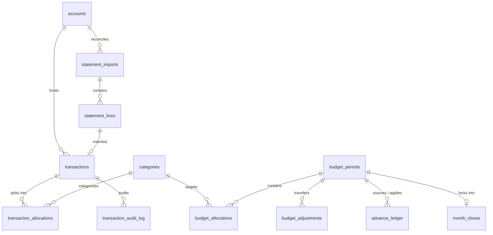
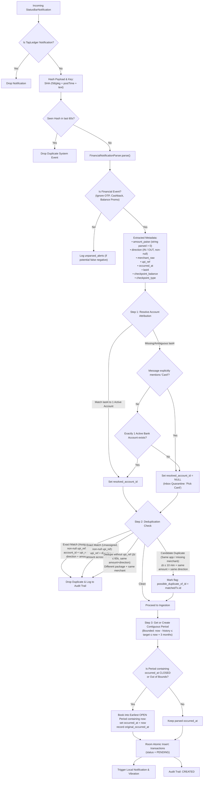
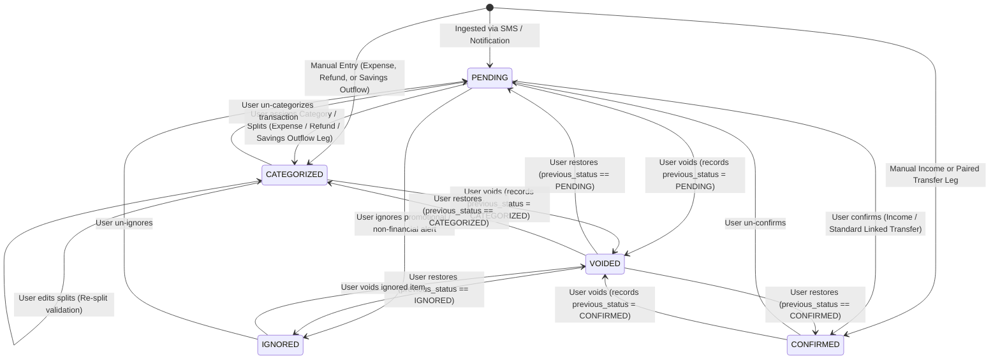
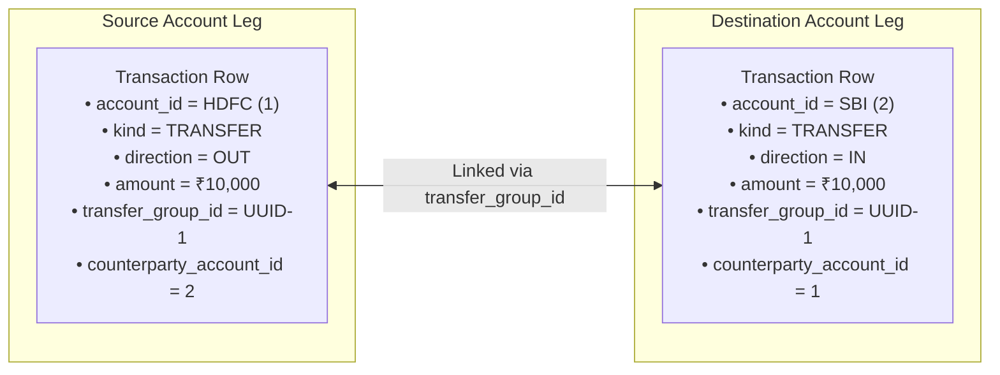
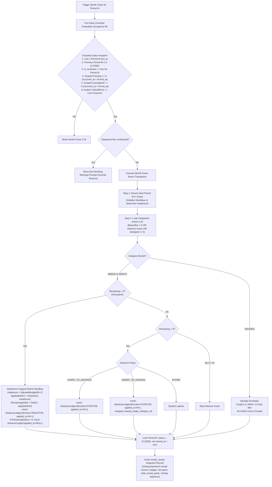
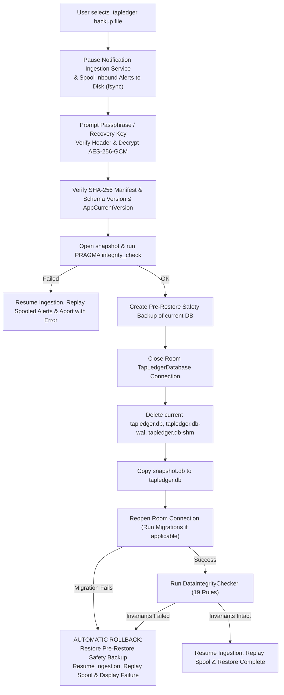
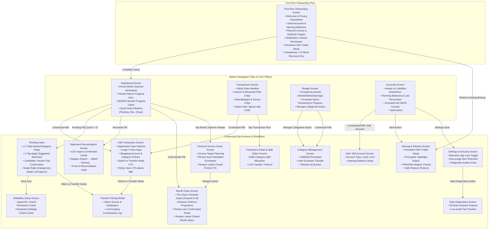

# TapLedger: Complete System Flows & Mathematical Specification

> **Version:** 2.5 (Formal Specification & Production Engine Architecture)  
> **Target OS:** Android 10+ (API 29–36, Android 16 Ready), Optimized for Xiaomi/HyperOS, Samsung OneUI, and Pixel  
> **Core Architectural Principles:** Single-user, 100% offline-first, Zero floating-point arithmetic (`Long` paise only), Transfer-level double-entry and envelope integrity, Asia/Kolkata (`IST`) timezone.

---

## Table of Contents

1. [Core Mathematical Primitives & String-Based Money Parsing](#1-core-mathematical-primitives--string-based-money-parsing)
2. [Data Model & Comprehensive Entity-Relationship Architecture](#2-data-model--comprehensive-entity-relationship-architecture)
3. [Notification Ingestion, Attribution & Deduplication Pipeline](#3-notification-ingestion-attribution--deduplication-pipeline)
4. [Transaction Lifecycle & Complete State Machine](#4-transaction-lifecycle--complete-state-machine)
5. [Pending Inbox & Adaptive Merchant Learning](#5-pending-inbox--adaptive-merchant-learning)
6. [Account Balance, Drift & Net Worth Mathematics](#6-account-balance-drift--net-worth-mathematics)
7. [Transfer Architecture & Counterparty Pairing](#7-transfer-architecture--counterparty-pairing)
8. [50/30/20 Envelope Budgeting System](#8-503020-envelope-budgeting-system)
9. [Multi-Split Category Allocation & Capacity-Capped Refund Math](#9-multi-split-category-allocation--capacity-capped-refund-math)
10. [Budget Period Lifecycle & Ordered Month-Close Engine](#10-budget-period-lifecycle--ordered-month-close-engine)
11. [Bank Statement Reconciliation Engine & Mathematical Proof](#11-bank-statement-reconciliation-engine--mathematical-proof)
12. [Data Integrity & Invariant Auditor (19 Formal Rules)](#12-data-integrity--invariant-auditor-19-formal-rules)
13. [Atomic Backup, Manifest Bundling & Safe Restore Protocol](#13-atomic-backup-manifest-bundling--safe-restore-protocol)
14. [Security, Privacy, and System Health Architecture](#14-security-privacy-and-system-health-architecture)
15. [End-to-End Application Screen Flow](#15-end-to-end-application-screen-flow)
16. [Engineering Guarantees & Non-Claims](#16-engineering-guarantees--non-claims)

---

## 1. Core Mathematical Primitives & String-Based Money Parsing

### 1.1 The Integer-Only Rule (Zero Float / Zero Double)

All financial storage and arithmetic in TapLedger are strictly executed as **signed 64-bit integers (`Long`) in Indian Paise**:
$$\text{paise} = \text{rupees} \times 100$$
Floating-point primitives (`Float`, `Double`, `BigDecimal` conversions through double) are strictly forbidden in business logic, calculation engines, and database storage. Binary floating-point arithmetic fails on decimal numbers (e.g., $1.15 \times 100 = 114.99999999999999$), causing financial balance drift.

### 1.2 Deterministic String-Based Paise Parser

To prevent floating-point inaccuracies, parse currency strings robustly, reject non-ASCII digits, enforce positive values, and apply a sanity cap:

```kotlin
fun parseRupeesStringToPaise(raw: String): Long {
    // 1. Strip trailing sentence punctuation, Indian '/-' suffix (e.g. "Rs. 500/-."), symbols, and whitespace
    var cleaned = raw.trim().trimEnd('.').replace(Regex("/-\\s*$"), "").trimEnd('.')
    cleaned = cleaned.replace(Regex("[₹,\\s]|Rs\\.?|INR", RegexOption.IGNORE_CASE), "").trim()
    if (cleaned.isEmpty()) throw IllegalArgumentException("Empty amount: $raw")

    // 2. Tokenize on decimal point
    val parts = cleaned.split(".")
    if (parts.size > 2) throw IllegalArgumentException("Multiple decimal points: $raw")

    // 3. Whole part parsing (ASCII digits only; support empty leading whole ".50" -> 0)
    val wholeStr = if (parts[0].isEmpty()) "0" else parts[0]
    if (!wholeStr.all { it in '0'..'9' }) throw IllegalArgumentException("Non-ASCII/digit whole part: $raw")
    val wholePart = wholeStr.toLong()

    // 4. Fraction part parsing (ASCII digits only, max 2 decimals)
    val fractionStr = if (parts.size == 2) parts[1] else ""
    if (fractionStr.isNotEmpty() && !fractionStr.all { it in '0'..'9' }) {
        throw IllegalArgumentException("Non-ASCII/digit fraction part: $raw")
    }
    if (fractionStr.length > 2) {
        throw IllegalArgumentException("Sub-paise precision rejected (>2 decimals): $raw")
    }

    // Right-pad single digit (e.g., ".5" -> "50") or use "00"
    val paddedFraction = fractionStr.padEnd(2, '0').toLong()
    val totalPaise = Math.addExact(Math.multiplyExact(wholePart, 100L), paddedFraction)

    // 5. Positive amount & sanity cap enforcement (Max ₹100 Crores)
    val maxSanityPaise = 100_00_00_000_00L
    if (totalPaise <= 0L) throw IllegalArgumentException("Amount must be strictly positive: $raw")
    if (totalPaise > maxSanityPaise) throw IllegalArgumentException("Amount exceeds sanity cap (₹100 Cr): $raw")

    return totalPaise
}
```

### 1.3 Indian Numbering System & Tabular Figures

Display conversion is performed exclusively at the UI boundary via `MoneyFormatter`:

- Format pattern: Indian grouping (`12,34,567.89`).
- Rendered with tabular proportional numerals (`fontFeatureSettings = "tnum"`).
- **Semantic Display:**
  $$\text{Income / Refund / Interest Earned: } +\text{₹}X.XX \quad (\text{IncomeGreen})$$
  $$\text{Expense / Fee / Interest Charged: } -\text{₹}X.XX \quad (\text{ExpenseRed})$$
  $$\text{Credit Card / Loan Debt: } -\text{₹}X.XX \text{ or } \text{₹}X.XX \text{ owed}$$

### 1.4 Timezone & Period Boundary Invariant

- Storage timestamps: Epoch milliseconds (`Long`).
- All day, month, and year boundaries are computed in **`Asia/Kolkata` (`IST` / `UTC+05:30`)**.
- Budget periods follow **half-open intervals**:
  $$[\text{start\_at}, \text{end\_at}) = \{t \mid \text{start\_at} \le t < \text{end\_at}\}$$
- Opening balance dates are anchored to **`StartOfDayIST(opening_balance_date)`** ($00:00:00.000$ IST), so same-day opening transactions are captured.

---

## 2. Data Model & Comprehensive Entity-Relationship Architecture



### Full Table Schema Specifications

- **`accounts`**:
  `id` (PK), `name`, `type` (`BANK`, `CREDIT_CARD`, `CASH`, `INVESTMENT`, `LOAN`, `WALLET`), `identifier_last4`, `opening_balance_paise` (signed integer, negative for CC/LOAN debt), `opening_balance_date` (epoch ms, start-of-day IST), `credit_limit_paise`, `statement_day`, `due_day`, `is_savings` (BOOLEAN, default false), `is_active`, `created_at`, `updated_at`.
- **`transactions`**:
  `id` (PK), `account_id` (FK, Nullable), `kind` (`EXPENSE`, `INCOME`, `REFUND`, `TRANSFER`, `FEE`, `INTEREST_CHARGED`, `INTEREST_EARNED`, `ADJUSTMENT`), `direction` (`OUT`, `IN`, NOT NULL), `amount_paise` (> 0), `merchant_raw`, `status` (`PENDING`, `CONFIRMED`, `CATEGORIZED`, `IGNORED`, `VOIDED`), `previous_status`, `source` (`SMS`, `NOTIFICATION`, `STATEMENT`, `MANUAL`), `occurred_at` (epoch ms), `original_occurred_at` (epoch ms, nullable), `upi_reference`, `transfer_group_id` (UUID, nullable), `counterparty_account_id` (FK, nullable), `refund_of_transaction_id` (FK, nullable), `possible_duplicate_of_id` (FK, nullable), `checkpoint_balance_paise` (nullable), `checkpoint_type` (`AVAILABLE_BALANCE`, `AVAILABLE_CREDIT_LIMIT`, `TOTAL_OUTSTANDING`, nullable), `notes`, `created_at`, `updated_at`.
- **`transaction_allocations`**:
  `id` (PK), `transaction_id` (FK), `category_id` (FK), `amount_paise` (> 0).  
  _Unique Composite Index:_ `(transaction_id, category_id)`.
- **`categories`**:
  `id` (PK), `name`, `system_key` (VARCHAR, Unique, Nullable), `default_bucket` (`NEEDS`, `WANTS`, `SAVINGS`), `default_sort_order`, `default_advance_policy` (`CARRY_TO_ADVANCE`, `SWEEP_TO_SAVINGS`, `EXPIRE`), `sweep_target_category_id` (FK, nullable), `is_active`.
- **`budget_periods`**:
  `id` (PK), `year`, `month`, `start_at` (inclusive), `end_at` (exclusive), `income_paise` (planned target), `is_reviewed` (BOOLEAN, default false), `status` (`OPEN`, `CLOSED`), `closed_at` (epoch ms, nullable), `created_at`, `updated_at`.  
  _Unique Composite Index:_ `(year, month)`.
- **`budget_allocations`**:
  `id` (PK), `budget_period_id` (FK), `category_id` (FK), `category_name_snapshot`, `bucket_snapshot` (`NEEDS`, `WANTS`, `SAVINGS`), `sort_order_snapshot`, `advance_policy_snapshot`, `amount_paise` ($\ge 0$).  
  _Unique Composite Index:_ `(budget_period_id, category_id)`.
- **`budget_adjustments`**:
  `id` (PK), `budget_period_id` (FK), `from_category_id` (FK), `to_category_id` (FK), `amount_paise` (> 0), `reason`, `created_at`.
- **`advance_ledger`**:
  `id` (PK), `source_period_id` (FK), `applied_to_period_id` (FK, Nullable), `category_id` (FK), `amount_paise` (> 0), `direction` (`POSITIVE`, `NEGATIVE`), `reason`, `created_at`.
- **`month_closes`**:
  `id` (PK), `budget_period_id` (FK, Unique), `closed_at`, `planned_income_paise`, `actual_income_paise`, `total_budgeted_paise`, `total_spent_paise`, `total_saved_paise`, `reconciliation_status` (`RECONCILED`, `RECONCILED_WITH_OVERRIDE`, `UNRECONCILED`), `override_reason`, `closing_balances_json`.
- **`statement_imports`**:
  `id` (PK), `account_id` (FK), `period_start`, `period_end`, `opening_balance_paise`, `closing_balance_paise`, `total_debits_paise`, `total_credits_paise`, `line_count`, `status` (`IMPORTED`, `RECONCILED`, `ARITHMETIC_ERROR`, `CANCELLED`), `created_at`.
- **`statement_lines`**:
  `id` (PK), `import_id` (FK), `transaction_date`, `value_date`, `description`, `reference`, `debit_paise`, `credit_paise`, `balance_after_paise`, `matched_transaction_id` (FK), `match_status` (`MATCHED`, `MATCHED_WITH_DISCREPANCY`, `MISSING_IN_APP`, `MISSING_IN_STATEMENT`, `TIMING_DIFFERENCE`, `RESOLVED`).
- **`unparsed_alerts`**:
  `id` (PK), `package_name`, `title`, `raw_text`, `occurred_at`, `error_reason`, `created_at`. _(Purged after 30 days)._
- **`merchant_map`**:
  `id` (PK), `merchant_normalized`, `category_id` (FK), `times_confirmed`, `times_overridden`, `last_used_at`.  
  _Unique Composite Index:_ `(merchant_normalized, category_id)`.  
  _Storage Invariant:_ `merchant_normalized` stores the full canonical merchant VPA (e.g. `swiggy.bangalore@icici`) or normalized retail descriptor, never truncated wildcard patterns (e.g. `paytmqr*`), preventing distinct vendors from colliding.
- **`transaction_audit_log`**:
  `id` (PK), `transaction_id` (FK, Nullable), `action` (`CREATED`, `UPDATED`, `CATEGORIZED`, `UNCATEGORIZED`, `SPLIT`, `TRANSFER_LINKED`, `REFUND_LINKED`, `VOIDED`, `IGNORED`, `RESTORED`, `DUPLICATE_DROPPED`, `PERIOD_CLOSED`, `PERIOD_REOPENED`, `DB_RESTORED`), `before_snapshot_json` (Nullable), `after_snapshot_json` (Nullable), `reason`, `created_at`.

### Database Integrity Triggers (Rule M1 Hard Prevention)

To guarantee immutability of closed budget periods without relying solely on application-layer checks:

- **Transactions Table (`transactions`):**
  - `BEFORE UPDATE`: Raises `RAISE(ABORT, 'Cannot alter transaction in closed period')` if any update attempts to modify `amount_paise`, `direction`, `account_id`, `occurred_at`, `status`, or `kind` when the period containing `occurred_at` has `status = 'CLOSED'`.
  - `BEFORE INSERT`: Raises abort if a back-dated transaction is inserted with `occurred_at` falling inside a closed period.
  - `BEFORE DELETE`: Raises abort if attempting to delete any transaction residing in a closed period.
- **Advance Ledger Table (`advance_ledger`):**
  - Keyed strictly on `applied_to_period_id` (not `source_period_id`, allowing historical closed source months to generate new absorption rows into open target months):
  - When `applied_to_period_id IS NOT NULL`: `BEFORE INSERT / UPDATE / DELETE` triggers abort if the target applied period is `CLOSED`.
  - When `applied_to_period_id IS NULL` (unassigned deficit pool): Append-only `INSERT` is permitted; `BEFORE UPDATE` and `BEFORE DELETE` triggers strictly abort modifications.
- **Budget Envelopes & Allocations (`budget_allocations`, `transaction_allocations`, `budget_adjustments`):**
  - SQLite `BEFORE INSERT / UPDATE / DELETE` triggers raise abort whenever the associated budget period has `status = 'CLOSED'`.

---

## 3. Notification Ingestion, Attribution & Deduplication Pipeline



### 3.1 Attribution & Deduplication Invariants

- **Non-Null Direction:** Every transaction stores a non-null `direction` (`IN` for credits, deposits, refunds, interest earned, transfer in; `OUT` for debits, expenses, fees, interest charged, transfer out). This ensures SQLite unique indexes and equality queries never evaluate `NULL = NULL`.
- **Deduplication Key Formulations:**
  1. **Exact Key with Non-Null `upi_reference`:**
     - Assigned (`account_id IS NOT NULL`): Matches on `(account_id, upi_reference, direction, amount_paise)`.
     - Unassigned (`account_id IS NULL`): Matches on `(upi_reference, direction, amount_paise)` globally across all transactions.
  2. **Deduplication Without `upi_reference` (Preventing False Drop of Legitimate Rapid Purchases):**
     - Matches on `(account_id, amount_paise, direction, occurred_at)` within $\Delta t \le 60\text{s}$ are treated as exact duplicates **only if** both alerts share the exact same merchant string AND originate from **different source packages** (e.g. Bank SMS vs. UPI push notification).
     - If both alerts originate from the same app or lack merchant metadata, the alert is **not silently dropped**; instead, it is ingested with `possible_duplicate_of_id = matchedTx.id` for user review (preventing accidental loss of two legitimate identical ₹50 transit fares tapped within the same minute).
- **Account Nullability & Quarantine:**
  - If an account cannot be resolved unequivocally, `account_id` remains `NULL`.
  - **Invariant:** A transaction **cannot transition to `CONFIRMED` or `CATEGORIZED`** while `account_id` is `NULL`.
  - **Exemption:** Transitions from `PENDING` $\rightarrow$ `IGNORED` or `PENDING` $\rightarrow$ `VOIDED` are permitted with `account_id = NULL`, allowing users to discard unassigned promotional/duplicate alerts without choosing an account.
  - Unassigned transactions do not hit any account balance and are exempted from rule `T1`.
  - The Pending Inbox displays an amber warning banner: `"Unassigned Account — Tap to resolve"`.
  - Month-close for period $M$ is strictly blocked if any unassigned transaction exists with `occurred_at < M.end_at`.
- **Bounded Contiguous Period Get-or-Create:**
  - To prevent runaway row generation caused by malformed notification years (e.g. year 2099), period seeding is strictly bounded:
    $$\text{occurred\_at} \le \text{now} + 1 \text{ day} \quad \land \quad \text{Month}(\text{occurred\_at}) \le \text{Month}(\text{now}) + 3$$
  - If a transaction arrives with $\text{occurred\_at} > \text{now} + 1 \text{ day}$ or $> 3 \text{ months ahead}$, the engine clamps $\text{occurred\_at} = \text{now}$ and records `original_occurred_at = parsed`.
  - Similarly, if `occurred_at < FirstPeriod.start_at`, it is clamped to `now` with `original_occurred_at` preserved.
  - **Transient UI Browsing:** Navigating to future months in the UI displays a transient in-memory preview without writing rows to `budget_periods` until transactions arrive or the user taps "Initialize Budget".

---

## 4. Transaction Lifecycle & Complete State Machine



### Comprehensive Status Impact Matrix

| Status            |         Account Balance         | Budget Spending | Category Envelopes | Statement Reconciliation | Notes                                                                             |
| :---------------- | :-----------------------------: | :-------------: | :----------------: | :----------------------: | :-------------------------------------------------------------------------------- |
| **`PENDING`**     | **YES** (if account $\ne$ null) |       NO        |         NO         |         **YES**          | Deducts balance immediately; envelope unassigned                                  |
| **`CONFIRMED`**   |             **YES**             |       NO        |         NO         |         **YES**          | Income and standard paired transfers                                              |
| **`CATEGORIZED`** |             **YES**             | **YES** (N & W) |      **YES**       |         **YES**          | Splits sum to `amount_paise`; Savings OUT legs hit Savings Goals, not spend total |
| **`IGNORED`**     |               NO                |       NO        |         NO         |            NO            | Excluded from financial math                                                      |
| **`VOIDED`**      |               NO                |       NO        |         NO         |            NO            | Reversible cancellation; audit preserved                                          |

---

## 5. Pending Inbox & Adaptive Merchant Learning

### 5.1 Dynamic Integer Confidence Scoring

Confidence is computed without floating-point primitives:
$$\text{IsHighConfidence}(M) \iff (\text{times\_confirmed}(M) \times 100\text{L}) \ge (80\text{L} \times (\text{times\_confirmed}(M) + \text{times\_overridden}(M))) \land (\text{times\_confirmed}(M) \ge 2)$$

- **1-Tap Shortcut Displayed:** Shown only when `IsHighConfidence` evaluates to `true`.
- **Strict Guard against P2P & Data Poisoning:**
  1. **P2P Rejection:** VPAs with telephone numbers (e.g. `9876543210@paytm`) or individual personal names (e.g. `rahul.verma@okhdfcbank`) denote peer-to-peer transfers and are **strictly excluded** from learning.
  2. **Merchant Qualification & Canonical Key:** Learning is applied strictly to verified commercial patterns: QR merchant handles, branded service VPAs (`swiggy@*`, `uber@*`, `zomato@*`), or card POS clearing descriptors with commercial MCC codes. In `merchant_map`, `merchant_normalized` stores the full distinct VPA / merchant descriptor (e.g. `paytmqr2810050501011@paytm` or `SWIGGY_BANGALORE`), never truncated wildcard patterns (e.g. `paytmqr*`), preventing distinct vendors from colliding into a single mapping.
  3. **No Learning from Splits:** Multi-category split allocations are ambiguous and never increment `times_confirmed`.
  4. **Override Penalty:** User overrides increment `times_overridden`, instantly suppressing the 1-tap shortcut below the $80\%$ threshold.

### 5.2 Interaction Latency: $\le 2$ Taps Target

1. **Tap 1 (Bucket Selection):** User taps `Needs`, `Wants`, or `Savings`.
   - Bucket with **exactly 1 category**: Automatically allocates $100\%$ amount and commits. Total = **1 Tap**.
   - Bucket with **multiple categories**: Expands sub-category chips inline.
2. **Tap 2 (Category Selection):** User taps category chip. Allocates $100\%$ and commits. Total = **2 Taps**.

---

## 6. Account Balance, Drift & Net Worth Mathematics

### 6.1 Individual Account Balance Formula with As-Of Boundary

For account $A$ as of timestamp $T_{\text{asOf}}$:
$$\text{Balance}(A, T_{\text{asOf}}) = A.\text{opening\_balance\_paise} + \sum_{t \in T_{\text{in}}(A, T_{\text{asOf}})} t.\text{amount\_paise} - \sum_{t \in T_{\text{out}}(A, T_{\text{asOf}})} t.\text{amount\_paise}$$

#### Boundary & Eligibility Rules:

1. $t.\text{occurred\_at} \ge \text{StartOfDayIST}(A.\text{opening\_balance\_date})$.
2. $t.\text{occurred\_at} \le T_{\text{asOf}}$ (caps future-dated transactions from current balance).
3. $t.\text{status} \in \{\text{PENDING}, \text{CONFIRMED}, \text{CATEGORIZED}\}$.
4. **Sign Convention:** Credit card and loan opening balances are stored as **negative integers** ($-\text{₹}8,000.00 = -800000\text{ paise}$).
5. **Per-Account Opening Balance Lock:** An account's opening balance is locked from edits once any `CLOSED` period satisfies $\text{end\_at} > \text{StartOfDayIST}(A.\text{opening\_balance\_date})$. This ensures an account opened on Jan 15 is locked if January is closed (since January's $\text{end\_at}$ is Feb 1 $00:00:00 \text{ IST} > \text{Jan 15}$). A new account's `opening_balance_date` must fall within a currently `OPEN` period.

#### Inflow vs. Outflow Mapping:

With non-null `direction` stored on every transaction row:

- **Inflow ($T_{\text{in}}$):** All qualifying transactions with $t.\text{direction} = \text{IN}$ (`INCOME`, `REFUND`, `INTEREST_EARNED`, transfer credit, and positive `ADJUSTMENT`).
- **Outflow ($T_{\text{out}}$):** All qualifying transactions with $t.\text{direction} = \text{OUT}$ (`EXPENSE`, `FEE`, `INTEREST_CHARGED`, transfer debit, and negative `ADJUSTMENT`).

### 6.2 Type-Agnostic Net Worth Identity

To ensure $\mathbf{Assets} - \mathbf{Liabilities} \equiv \sum_{A} \text{Balance}(A)$ holds universally across all account types:

$$\mathbf{Assets}(T_{\text{asOf}}) = \sum_{A \in \text{Accounts}} \max(\text{Balance}(A, T_{\text{asOf}}), 0\text{L})$$

$$\mathbf{Liabilities}(T_{\text{asOf}}) = \sum_{A \in \text{Accounts}} \max(-\text{Balance}(A, T_{\text{asOf}}), 0\text{L})$$

$$\mathbf{NetWorth}(T_{\text{asOf}}) = \mathbf{Assets}(T_{\text{asOf}}) - \mathbf{Liabilities}(T_{\text{asOf}}) \equiv \sum_{A \in \text{Accounts}} \text{Balance}(A, T_{\text{asOf}})$$

- **Display Grouping & Warnings:**
  - If a `BANK`, `CASH`, or `WALLET` account drops negative, it contributes mathematically to $\text{Liabilities}$ (preserving identity), but the UI renders an amber **Data Inconsistency Warning Banner** (indicating missing opening balance or untracked cash income).
  - `INVESTMENT` accounts support manual asset valuation adjustment transactions (`ADJUSTMENT`).
  - **Credit Card Utilization:**
    $$\text{Utilization\%} = \begin{cases} \min\left(999, \max\left(0, \left\lfloor \frac{|\text{Balance}(A)| \times 100\text{L}}{A.\text{credit\_limit\_paise}} \right\rfloor\right)\right), & \text{if } A.\text{credit\_limit\_paise} > 0 \land \text{Balance}(A) < 0 \\ 0, & \text{otherwise} \end{cases}$$
- **Deactivated Account Rule:** Deactivating an account is blocked unless $\text{Balance}(A, \text{now}) = 0\text{L}$. Hidden accounts remain active in net worth calculations.

### 6.3 Real-Time Balance Drift Formula

When SMS reports a checkpoint balance (using signed values to correctly handle overpaid cards):

$$
\text{ExpectedBankBalance} = \begin{cases}
\text{Balance}(A, t.\text{occurred\_at}), & \text{if } \text{checkpoint\_type} = \text{AVAILABLE\_BALANCE} \\
A.\text{credit\_limit\_paise} + \text{Balance}(A, t.\text{occurred\_at}), & \text{if } \text{checkpoint\_type} = \text{AVAILABLE\_CREDIT\_LIMIT} \\
-\text{Balance}(A, t.\text{occurred\_at}), & \text{if } \text{checkpoint\_type} = \text{TOTAL\_OUTSTANDING}
\end{cases}
$$

$$\mathbf{BalanceDrift} = t.\text{checkpoint\_balance\_paise} - \text{ExpectedBankBalance}$$

- **Stability Protocol:** Drift banner is displayed only if:
  1. $t$ is the **latest** ingested checkpoint for account $A$.
  2. Account $A$ has **zero** unassigned `PENDING` transactions.
  3. A 5-minute stability window has elapsed since notification ingestion (absorbing out-of-order SMS deliveries).

---

## 7. Transfer Architecture & Counterparty Pairing

A transfer is a two-legged double-entry transaction. Both legs share a `transfer_group_id` (UUID).



### 7.1 Transfer Ingestion, Candidate Pairing & Lifecycle Synchronization

1. **Candidate Transfer Detection & Reciprocal Pairing:** When a transaction arrives, the engine queries for existing unlinked `PENDING` transactions in different accounts with:
   - Equal `amount_paise`.
   - Opposite `direction` (`OUT` vs `IN`).
   - $|t.\text{occurred\_at} - \text{candidate}.\text{occurred\_at}| \le 24 \text{ hours}$.
   - To prevent silent collisions (e.g. accidentally fusing a salary credit with an unrelated same-day rent payment), the engine surfaces a **Candidate Transfer Pair** card in the Pending Inbox:
     `"Potential Transfer: HDFC (-₹10,000) ↔ SBI (+₹10,000) — Tap to Confirm Link"`.
   - Upon user confirmation, Room atomically links both rows: assigns a shared `transfer_group_id`, sets `counterparty_account_id` reciprocally (`Leg1.counterparty_account_id = Leg2.account_id` and vice-versa), updates `kind = TRANSFER`, and transitions standard transfers to `CONFIRMED`.
   - **Savings Category Prompt:** If the destination account is flagged `is_savings = true` or `type = INVESTMENT`, the confirmation flow prompts the user to select a `SAVINGS` category. Until selected, the `OUT` leg remains `PENDING` while the `IN` leg becomes `CONFIRMED`. Upon selection, the `OUT` leg transitions to `CATEGORIZED`.
2. **Manual Leg Creation:** If only one leg was captured via SMS/Notification, user taps "Mark as Transfer" in Inbox:
   - Leg 1 (`OUT`) is assigned to the source account.
   - Leg 2 (`IN`) is atomically generated in destination account with matching `amount_paise`, inverted `direction = IN`, reciprocal `counterparty_account_id`, and shared `transfer_group_id`.
3. **Lifecycle Synchronization & Split Adjustment Protection:**
   - Voiding, ignoring, or restoring one transfer leg automatically updates the counterparty leg.
   - **Amount Edit & Re-Split Guard:** If the user edits `amount_paise` on a transfer leg whose counterpart `OUT` leg is `CATEGORIZED`, the change synchronizes to the counterparty amount, and the app immediately forces a **Split Adjustment Sheet** to adjust the category allocations to match the new `amount_paise`, preventing violation of Rule `A1`.
   - **Savings Transfer Status Exemption:** For transfers directed to savings accounts (§8.3), the `OUT` leg carries `status = CATEGORIZED` (with its `SAVINGS` envelope split) while the `IN` leg carries `status = CONFIRMED`. Status changes from normal envelope edits do not alter the `IN` leg's `CONFIRMED` status.
4. **Credit Card Bill Payments:**
   - $HDFC \rightarrow Card$: HDFC decreases (`direction = OUT`); Card increases from $-\text{₹}8,000$ to $\text{₹}0$ (`direction = IN`).
   - Standard transfers carry **zero category allocations** and do not impact budget expenses. Card purchases were already allocated to budget envelopes at the time of purchase.

---

## 8. 50/30/20 Envelope Budgeting System

### 8.1 Zero-Remainder Target Math

For planned monthly income $I$ (in paise):
$$\text{NeedsTarget} = \left\lfloor \frac{I \times 50\text{L}}{100\text{L}} \right\rfloor$$
$$\text{WantsTarget} = \left\lfloor \frac{I \times 30\text{L}}{100\text{L}} \right\rfloor$$
$$\text{SavingsTarget} = I - \text{NeedsTarget} - \text{WantsTarget}$$

- **Invariant:** $\text{NeedsTarget} + \text{WantsTarget} + \text{SavingsTarget} \equiv I$.
- **Income Definition:** `income_paise` on `budget_periods` represents the planned budget target. Actual verified income is derived dynamically:
  $$\text{ActualIncome} = \sum_{t \in T_{\text{income}}} t.\text{amount\_paise}$$
  Where $T_{\text{income}}$ is strictly defined as:
  $$T_{\text{income}} = \{t \mid t.\text{kind} \in \{\text{INCOME}, \text{INTEREST\_EARNED}\} \land t.\text{status} \in \{\text{CONFIRMED}, \text{CATEGORIZED}\} \land t.\text{direction} = \text{IN}\}$$
  (Excluding transfers, refunds, adjustments, and unassigned alerts).

### 8.2 Category Adjusted Budget Formula & DAO Invariant Guard

$$\text{AdjustedBudget}(C) = \text{BaseAllocated}(C) + \text{AdjIn}(C) - \text{AdjOut}(C) + \text{AdvancePositive}(C) - \text{AdvanceNegative}(C)$$

- **DAO Guard (Rule B2 Protection):** To guarantee $\text{AdjustedBudget}(C) \ge 0\text{L}$ at all times without relying on retroactive checks, every base allocation write and envelope adjustment insertion is verified against:
  $$\text{BaseAllocated}(C) \ge \text{AdvanceNegative}(C) + \text{AdjOut}(C) - \text{AdjIn}(C) - \text{AdvancePositive}(C)$$
  Any user action violating this boundary is rejected at the DAO layer with an `IllegalArgumentException`.
- **Universal Zero-Base Seeding Invariant:** Whenever any category receives an advance ledger row in Month $M+1$ (whether through `SWEEP_TO_SAVINGS` or `CARRY_TO_ADVANCE`) but lacks an active `budget_allocations` row in that period, the engine automatically seeds an allocation row with `amount_paise = 0L` to anchor the advance. Categories using `SWEEP_TO_SAVINGS` must target an active category residing in the `SAVINGS` bucket.

### 8.3 Net Spending Formulation & Savings Envelope Tracking

$$\text{NetSpent}(C) = \sum_{t \in T_{\text{exp}}(C)} \text{Allocated}(t, C) - \sum_{t \in T_{\text{ref}}(C)} \text{Allocated}(t, C) + \sum_{t \in T_{\text{sav\_transfer}}(C)} \text{Allocated}(t, C)$$

Where transactions must satisfy:

1. $t.\text{status} = \text{CATEGORIZED}$.
2. $t.\text{occurred\_at} \in [\text{Period.start\_at}, \text{Period.end\_at})$ (Half-open).
3. **Savings Contributions & Withdrawals:**
   - **Contributions (Transfers to Savings):** Money transferred to a savings vehicle (`destAccount.is_savings == true` or `type == INVESTMENT`) has its `OUT` leg categorized under the `SAVINGS` bucket. The `IN` leg remains `status = CONFIRMED` with zero allocations. This increments the Savings envelope's $\text{NetSpent}$.
   - **Withdrawals (Transfers from Savings):** Money transferred from a savings account back to operational checking accounts can carry a negative category allocation to that `SAVINGS` envelope, decrementing $\text{NetSpent}$:
     $$\text{NetSpent}(C_{\text{SAVINGS}}) = \sum \text{Allocated}(T_{\text{to\_savings}}, C) - \sum \text{Allocated}(T_{\text{from\_savings}}, C)$$
     This ensures withdrawals from emergency funds or deposits accurately reflect net savings reduction.
4. **Fees and Interest:** Bank fees (`FEE`) and interest charged (`INTEREST_CHARGED`) map to a system-protected Needs category (`system_key = "SYS_BANK_CHARGES"`).

### 8.4 Budget Evaluation Order & Savings Goal Semantics

To prevent edge-case rounding artifacts and treat savings as aspirational goals:

```kotlin
val isSavings = category.bucket == Bucket.SAVINGS

// 1. Savings Envelopes are Goals (Surplus is Celebrated, never Exceeded)
val isExceeded = if (isSavings) false else netSpent > adjustedBudget

val percentageUsed = if (adjustedBudget > 0L) {
    ((netSpent * 100L) / adjustedBudget).coerceIn(0L, 999L).toInt()
} else if (netSpent > 0L) 100 else 0

val isWarning = !isSavings && !isExceeded && percentageUsed in 80..100
val isGoalAchieved = isSavings && percentageUsed >= 100
```

- **Surplus Savings:** Stashing more than the target in a `SAVINGS` envelope never triggers an "Exceeded" warning and never carries an overspending deficit into Month $M+1$.
- **Under-Saved Remainder Semantics:** When net savings fall below the target ($\text{NetSpent} < \text{AdjustedBudget}$), the unfulfilled portion is an unrealized target, not a monetary debt. It never carries forward as a negative deficit. Under `EXPIRE` (default), the shortfall simply lapses. If configured as `CARRY_TO_ADVANCE`, it accumulates forward as an unfulfilled savings goal without debiting the next month's available cash.

### 8.5 Dashboard Hero vs. Actual Savings Metrics

To avoid distorting day-to-day living expense cards with savings transfers:

$$\mathbf{DashboardHeroSpend} = \sum_{C \in \text{NEEDS} \cup \text{WANTS}} \text{NetSpent}(C)$$
$$\mathbf{DashboardHeroBudget} = \sum_{C \in \text{NEEDS} \cup \text{WANTS}} \text{AdjustedBudget}(C)$$
$$\mathbf{ActualSavings} = \sum_{C \in \text{SAVINGS}} \text{NetSpent}(C)$$

---

## 9. Multi-Split Category Allocation & Capacity-Capped Refund Math

### 9.1 Split Remainder Invariant

When a transaction $T$ is split across $k$ categories:
$$\sum_{i=1}^{k} \text{AllocationPaise}(i) \equiv T.\text{amount\_paise}$$
Commit is blocked if remainder $\ne 0$, any allocation $\le 0$, or duplicate categories are selected.

### 9.2 Capacity-Capped Largest-Remainder Refund Apportionment

When a transaction $T$ with $k$ category splits is partially refunded by $R$ paise:

1. Compute remaining capacity for each category:
   $$\text{cap}_i = \text{AllocationPaise}(i) - \sum \text{PriorRefunds}_i(T)$$
   $$\text{TotalCap} = \sum_{i=1}^k \text{cap}_i$$
   If $R > \text{TotalCap}$, transaction rejected by Rule `R1_CUMULATIVE_REFUND_EXCEEDED`.
2. Compute base integer refund per category:
   $$\text{BaseRefund}_i = \left\lfloor \frac{R \times \text{cap}_i}{\text{TotalCap}} \right\rfloor$$
   $$\text{Remainder}_i = (R \times \text{cap}_i) \pmod{\text{TotalCap}}$$
3. Distribute unallocated paise ($R - \sum \text{BaseRefund}_i$) one paisa at a time to categories sorted deterministically by:
   - Descending $\text{Remainder}_i$.
   - Tie-break: Larger $\text{cap}_i$, then lower `category_id`.

- **Rule `R2_REFUND_EXCEEDS_CATEGORY_CAP`:** Guarantees $\text{Refund}_i \le \text{cap}_i$ for every split leg.

---

## 10. Budget Period Lifecycle & Ordered Month-Close Engine

### 10.1 Multi-Period Lifecycle Architecture

- **Contiguous Get-or-Create Initialization:** Budget periods are created contiguously on demand whenever an incoming transaction or UI navigation requires them. If a period does not exist for `occurred_at`, the engine contiguously seeds all intervening months up to the required period.
- **Auto-Population from Latest Existing Period:** When a new month is initialized, its base category allocations and `income_paise` are copied from the **latest existing period**, initialized with `is_reviewed = false` ("Needs Review" indicator).
- `is_reviewed = false` does not block notification ingestion, but closing a month requires `is_reviewed = true` (or explicit confirmation via the close wizard).
- **Sequential Closing:** Periods must be closed in strictly chronological order. Month $M$ cannot be closed unless Month $M-1$ is already `CLOSED`.
- **Reopen Capability & Downstream Absorption Protection:** The user can "Reopen latest closed period" strictly when no subsequent period is `CLOSED`. In the same Room transaction, any dependent deficit absorption rows created in open downstream periods ($M+1, \dots$) are atomically reverted and recalculated to eliminate orphaned absorption entries.

### 10.2 Month-Close Execution Flow



### 10.3 Headroom-Capped Append-Only Deficit Absorption & Priority

Uncovered deficits from previous closed months (`applied_to_period_id = NULL`) form an unassigned deficit pool:
$$\text{UncoveredPool}(C) = \sum_{r \in \text{Ledger}(applied\_to = \text{NULL}, direction = \text{NEGATIVE}, C)} r.\text{amount\_paise} - \sum_{r \in \text{Ledger}(applied\_to = \text{NULL}, direction = \text{POSITIVE}, C)} r.\text{amount\_paise}$$

#### Headroom Definition:

To prevent deficits from overshooting the budget and triggering DAO aborts when Month $M+1$ already contains adjustments or other advances, absorption is capped strictly by **available envelope headroom** (the period's current `AdjustedBudget`):
$$\text{Headroom}(C, M+1) = \text{BaseAllocated}(C, M+1) + \text{AdjIn}(C, M+1) - \text{AdjOut}(C, M+1) + \text{AdvPos}(C, M+1) - \text{AdvNeg}(C, M+1)$$

#### Ordered Absorption Protocol across Open Downstream Periods:

At **every** month-close, absorption runs sequentially across all currently `OPEN` downstream periods ($M+1, \dots$), drawing on available headroom with strict two-tier priority:

1. **Priority 1 (Historical Uncovered Pool):** Older debts are retired first:
   $$\text{AbsorbedFromPool} = \min(\text{UncoveredPool}(C), \text{Headroom}(C, M+1))$$
   If $\text{AbsorbedFromPool} > 0$:
   - **Offset Row:** Inserts `AdvanceLedger(source = M, applied_to = NULL, direction = POSITIVE, amount_paise = AbsorbedFromPool)` to reduce the unassigned pool.
   - **Application Row:** Inserts `AdvanceLedger(source = M, applied_to = M+1, direction = NEGATIVE, amount_paise = AbsorbedFromPool)`.
   - Update remaining headroom: $\text{Headroom}(C, M+1) \leftarrow \text{Headroom}(C, M+1) - \text{AbsorbedFromPool}$.
2. **Priority 2 (Newly Created Deficit from Month $M$):**
   $$\text{AppliedFromNew} = \min(\text{NewDeficit}(C, M), \text{Headroom}(C, M+1))$$
   $$\text{UncoveredNew} = \text{NewDeficit}(C, M) - \text{AppliedFromNew}$$
   - If $\text{AppliedFromNew} > 0$: Inserts `AdvanceLedger(source = M, applied_to = M+1, direction = NEGATIVE, amount_paise = AppliedFromNew)`.
   - If $\text{UncoveredNew} > 0$: Inserts `AdvanceLedger(source = M, applied_to = NULL, direction = NEGATIVE, amount_paise = UncoveredNew)` into the unassigned pool.

This ensures $\text{AdjustedBudget}(C, M+1) \ge 0\text{L}$ by construction, guaranteeing that the §8.2 DAO guard will never reject a valid month-close transaction.

---

## 11. Bank Statement Reconciliation Engine & Mathematical Proof

### 11.1 Statement Internal Arithmetic Verification

For bank accounts:
$$\text{ExpectedClosing} = \text{OpeningBalance} + \sum \text{Credits} - \sum \text{Debits}$$
For credit card accounts (imported converted to app sign: debt = negative):
$$\text{ExpectedClosing} = \text{OpeningBalance} + \sum \text{Payments/Credits} - \sum \text{Purchases/Debits}$$

- If $\text{ExpectedClosing} \ne \text{ReportedClosing}$: Status set to `ARITHMETIC_ERROR`.
- **Statement Chain Invariant:** $\text{Opening}(S_{n}) \equiv \text{Closing}(S_{n-1})$.

### 11.2 Two-Phase Matching Engine with Statement Window Boundaries

1. **Phase 1 (UPI / Reference Matching):**
   - Matches `line.reference` against `tx.upi_reference`.
   - If references match but amounts differ: Flagged as `MATCHED_WITH_DISCREPANCY`.
2. **Phase 2 (Global Minimal Delta Matching & Effective Timestamps):**
   - Because late-booked transactions might have their `occurred_at` clamped to `now` (§3.1), candidate matching evaluates delta using the original clearance timestamp:
     $$t_{\text{effective}} = \text{COALESCE}(t.\text{original\_occurred\_at}, t.\text{occurred\_at})$$
     $$\Delta t = |t_{\text{effective}} - \text{line}.\text{transaction\_date}| \le 2 \text{ days} \, (172,800,000 \text{ ms})$$
   - **Cross-Boundary Timing Difference:** Candidate pairs where the transaction date lies **outside the statement window $[period\_start, period\_end]$** (which follows `statement_day`, not calendar month boundaries) are classified as `TIMING_DIFFERENCE`.
   - Pairs are sorted globally by $\Delta t$ and assigned greedily, eliminating collision theft.
3. **Handling Unmatched Statement Lines (`MISSING_IN_APP`):**
   - Statement lines without matches can be imported as new app transactions, seeded with `status = PENDING`.
   - **Closed Period Guard:** If an unmatched statement line's date falls within an already `CLOSED` month, inserting into that closed period is blocked by the Rule `M1` trigger. Instead, the transaction is booked into the earliest `OPEN` period with `occurred_at = now` and `original_occurred_at = line.transaction_date`, linked to a reconciliation adjustment audit entry.

### 11.3 The Exact Mathematical Proof of Reconciliation

The reconciliation identity holds algebraically for any statement window $[period\_start, period\_end]$:

$$\mathbf{StmtClosing} - \mathbf{AppBalance}(\text{EndOfDayIST}(period\_end)) \equiv (\mathbf{StmtOpening} - \mathbf{AppBalance}(\text{StartOfDayIST}^-(period\_start))) + \sum_{l \in \text{MISSING\_IN\_APP}} s(l) - \sum_{t \in \text{MISSING\_IN\_STMT}} s(t) + \sum_{m \in \text{DISCREPANCY}} (s(m.\text{line}) - s(m.\text{tx})) + \sum_{k \in \text{TIMING\_DIFFERENCE}} s(k.\text{line})$$

Where:
$$s(x) = \begin{cases} +x.\text{amount\_paise}, & \text{if credit / income} \\ -x.\text{amount\_paise}, & \text{if debit / expense} \end{cases}$$

- **Proof Rationale Across Window Boundaries:**
  1. **Before Window Start ($t < period\_start$):** Transactions occurring before the statement cycle are completely absorbed by the opening-balance differential term $(\mathbf{StmtOpening} - \mathbf{AppBalance}(\text{StartOfDayIST}^-(period\_start)))$.
  2. **After Window End ($t > period\_end$):** When a statement line within $[period\_start, period\_end]$ is matched with an app transaction occurring *after* $period\_end$ (`TIMING_DIFFERENCE`), the statement line is included in $\mathbf{StmtClosing}$, but the app transaction does not exist in $\mathbf{AppBalance}(\text{EndOfDayIST}(period\_end))$. Adding $+ \sum_{k \in \text{TIMING\_DIFFERENCE}} s(k.\text{line})$ closes the algebraic proof exactly.

---

## 12. Data Integrity & Invariant Auditor (19 Formal Rules)

The `DataIntegrityChecker` audits the Room database against 19 formal rules:

| Rule Code                            | Invariant Condition                                                                                                                                |   Severity   | Description                                                  |
| :----------------------------------- | :------------------------------------------------------------------------------------------------------------------------------------------------- | :----------: | :----------------------------------------------------------- |
| **`T1_INVALID_ACCOUNT`**             | $\forall t \text{ with status} \notin \{\text{PENDING}, \text{IGNORED}, \text{VOIDED}\}, t.\text{account\_id} \in \text{Accounts.id}$              | **CRITICAL** | Orphaned transaction without account                                            |
| **`T2_NON_POSITIVE_AMOUNT`**         | $\forall t, t.\text{amount\_paise} > 0$                                                                                                            |  **ERROR**   | Non-positive transaction amount                                                 |
| **`T3_UNPAIRED_TRANSFER`**           | Every paired transfer has linked counterpart with equal amount, opposite direction, and reciprocal `counterparty_account_id`                      | **CRITICAL** | One-legged, unbalanced, or unlinked reciprocal transfer                         |
| **`T4_DUPLICATE_UPI_REF`**           | Unique non-null `(account_id, upi_reference, direction, amount_paise)`; if `account_id IS NULL`: unique `(upi_reference, direction, amount_paise)` |  **ERROR**   | Duplicate transaction captured                                                  |
| **`A1_SPLIT_SUM_MISMATCH`**          | For categorized $t$: $\sum \text{Allocations} \equiv t.\text{amount\_paise}$                                                                       | **CRITICAL** | Split allocation does not match transaction                                     |
| **`A2_INVALID_CATEGORY`**            | $\forall a, a.\text{category\_id} \in \text{Categories.id}$                                                                                        |  **ERROR**   | Allocation references non-existent category                                     |
| **`A3_NON_POSITIVE_ALLOCATION`**     | $\forall a, a.\text{amount\_paise} > 0$                                                                                                            |  **ERROR**   | Split allocation $\le 0$ paise                                                  |
| **`A4_DUPLICATE_CATEGORY_IN_SPLIT`** | Unique `(transaction_id, category_id)`                                                                                                             |  **ERROR**   | Category repeated in same split                                                 |
| **`B1_INVALID_ADJUSTMENT`**          | $\text{from\_cat} \in \text{Cat} \land \text{to\_cat} \in \text{Cat}$                                                                              |  **ERROR**   | Invalid category reference in transfer                                          |
| **`B2_NEGATIVE_BUDGET`**             | $\forall b, \text{AdjustedBudget}(b) \ge 0$ (enforced at DAO boundary)                                                                             | **CRITICAL** | Category adjusted budget dropped negative                                       |
| **`B3_BUCKET_OVERALLOCATION`**       | $\sum \text{BaseAllocations} \le \text{BucketTarget}$                                                                                              | **WARNING**  | Base envelopes exceed bucket target                                             |
| **`B4_BUDGET_EQUILIBRIUM`**          | $\sum \text{AdjustedBudget} \le \text{Period.income} + \text{NetAdvances}(P)$                                                                      | **WARNING**  | Budget envelope equilibrium exceeded; $\text{NetAdvances} = \sum \text{AdvPos} - \sum \text{AdvNeg}$ |
| **`C1_DUPLICATE_CATEGORY`**          | Unique active category names                                                                                                                       | **WARNING**  | Ambiguous duplicate categories                                                  |
| **`P1_PERIOD_OVERLAP`**              | No overlapping $[\text{start\_at}, \text{end\_at})$ intervals                                                                                      | **CRITICAL** | Corrupted budget period boundaries                                              |
| **`M1_LOCKED_MODIFICATION`**         | No row mutations targeting closed periods; enforced via SQLite `BEFORE` triggers raising abort                                                     | **CRITICAL** | Violation of historical ledger immutability                                     |
| **`M2_CLOSE_TOTALS_MISMATCH`**       | `month_closes` matches recomputed historical totals                                                                                                |  **ERROR**   | Historical close record tampering                                               |
| **`S1_STATEMENT_MISMATCH`**          | Internal statement arithmetic equals reported closing                                                                                              | **WARNING**  | Bank CSV arithmetic mismatch                                                    |
| **`R1_CUMULATIVE_REFUND_EXCEEDED`**  | $\sum \text{Refunds}(T) \le T.\text{amount\_paise}$                                                                                                |  **ERROR**   | Refunds exceed original charge                                                  |
| **`R2_REFUND_EXCEEDS_CATEGORY_CAP`** | $\forall \text{refund splits } i, \text{Refund}_i \le \text{cap}_i$                                                                                |  **ERROR**   | Refund allocated to category exceeds original spend capacity                    |

---

## 13. Atomic Backup, Manifest Bundling & Safe Restore Protocol

### 13.1 Atomic Snapshot, Persistent SAF Storage & Key Management

1. Triggers SQLite `VACUUM INTO 'snapshot.db'` (atomic snapshot).
2. Runs `PRAGMA integrity_check;` on snapshot connection.
3. Computes SHA-256 checksum, schema version, and record count manifest (`manifest.json`).
4. Bundles `snapshot.db` and `manifest.json` into a single archive (`.tapledger`).
5. **Scheduled Automatic Backups via Persistent SAF:**
   - Backups stored strictly in internal app storage are destroyed on app uninstall or "Clear Data".
   - TapLedger prompts the user during initial onboarding to designate a persistent backup directory via the Android Storage Access Framework (`ACTION_OPEN_DOCUMENT_TREE`) and persists URI access across reboots via `contentResolver.takePersistableUriPermission`.
   - WorkManager runs a daily background task exporting `.tapledger` snapshots directly to this persistent SAF folder (retaining 7 daily and 4 weekly archives).
6. **Portable Key Management & Encryption Architecture:**
   - **The Keystore Portability Trap:** Hardware-backed Android Keystore keys are non-exportable and wiped on uninstall or phone loss. Backups encrypted strictly with raw Keystore keys cannot be restored on a new device.
   - **Passphrase / Recovery Key Solution:** During setup, the user establishes a Master Backup Secret: either a user-supplied **Passphrase** or a 12-word **Recovery Mnemonic / Hex Key** displayed once to record.
   - **Key Derivation (Argon2id via BouncyCastle):**
     $$\text{MasterKey} = \text{Argon2id}(\text{Secret}, \text{salt}, \text{iterations} = 3, \text{memory} = 65536 \text{ KiB}, \text{parallelism} = 1)$$
   - **Unattended Background Encryption:** For daily WorkManager backups, the derived key is cached encrypted inside Android Keystore (`TapLedgerMasterKey`), allowing background backups without nightly password prompts.
   - **Cross-Device Restore:** On a new device or fresh install, the user restores the backup using their Passphrase or 12-word Recovery Key.
   - **Archive Header Format:** Bytes 0–3 (`TPLF`), Format Version (1 byte), Salt (16 bytes), IV/Nonce (12 bytes), Argon2id params (iterations 4B, memory 4B, parallelism 4B), Key Verification Tag (16 bytes).

### 13.2 Safe Restore Protocol with File-Backed Spool & Rollback Guard



- **File-Backed Notification Spool (Crash-Resilient Buffer):**
  Any notifications or SMS alerts arriving while the database connection is closed are written to a dedicated disk spool (`RestoreNotificationBuffer`) using `FileChannel.force(true)` (`fsync`). Once the database swap is verified (or rolled back), the spooled alerts are replayed through ingestion and the spool file is immediately securely deleted to prevent raw SMS texts from lingering on disk.

---

## 14. Security, Privacy, and System Health Architecture

### 14.1 Android Security & Privacy Boundaries

- `AndroidManifest.xml`: `android:allowBackup="false"`.
- `data_extraction_rules.xml`: Disables cloud and device-to-device transport of SQLite databases, encryption keys, and alert logs.
- No `android.permission.INTERNET` declared. The application code cannot transmit data over the network.
- **App Lock & Display Security:** Optional Android BiometricPrompt (Fingerprint/PIN); sets `FLAG_SECURE` on sensitive activities to prevent screenshot and app switcher leaks.
- **Storage Notice:** The SQLite database is stored unencrypted in Android app-private internal storage; root users on compromised devices can read app storage. Exports to external media can be encrypted with a user-supplied password.

### 14.2 Notification Listener Health & Rebind Protocol

- **Adaptive Health Check:** Calculates expected daily notification frequency based on user history; warns only when gap exceeds $3\times$ average inter-arrival time.
- **WorkManager Liveness Check:** Runs periodic background worker verifying `NotificationListenerService` connectivity (runs strictly offline without network constraints).
- On disconnect or process death, executes `requestRebind(ComponentName)`.
- **Deep-Link to App Info:** Android 13+ sideloads block notification listeners under "Restricted Settings". The app deep-links directly to the system App Info page where the user toggles "Allow restricted settings".
- Runtime permission `android.permission.POST_NOTIFICATIONS` requested on Android 13+ (API 33+).

---

## 15. End-to-End Application Screen Flow



---

## 16. Engineering Guarantees & Non-Claims

1. **Exact Financial Arithmetic:** All balances, envelopes, and net worth calculations run in 64-bit integer paise. Decimal floating-point drift is mathematically impossible.
2. **Crash & Power-Loss Resistance:** All SQLite mutations execute in `WAL` mode inside Room transactions (`database.withTransaction {}`). Uncommitted changes are rolled back on power loss.
3. **Transfer-Level Double-Entry & Envelope Integrity:** Transfers enforce balanced two-legged accounting (`T3`), split allocations equal parent transaction amounts (`A1`), and overspending is persistently rolled forward without violating budget non-negativity (`B2`, §10.3).
4. **Local Network Isolation:** The application declares no internet permissions, ensuring financial data cannot be transmitted over the network by the app itself. _(User-exported files via SAF are as secure as the external storage destination chosen by the user; local app-private storage is unencrypted at rest and accessible on rooted devices)._
